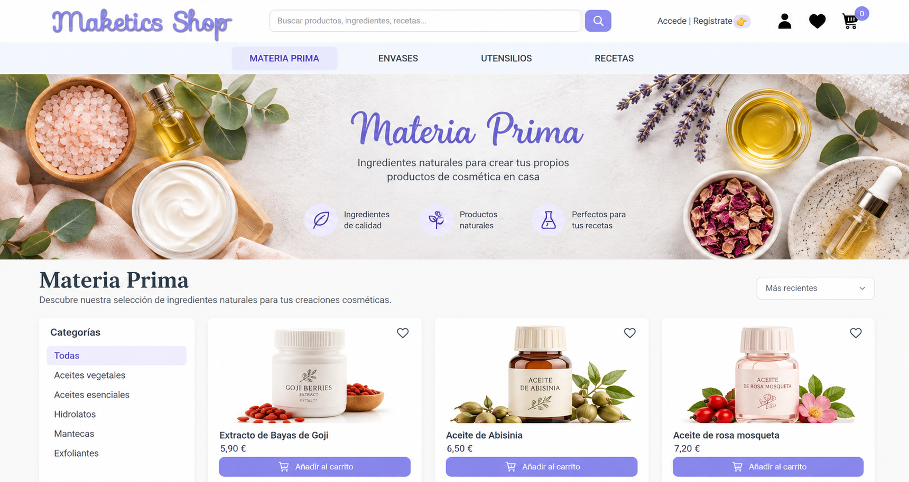

# 💜 Maketics Shop

### A full-stack e-commerce application for DIY cosmetics

Maketics Shop is a full-stack web application designed for people who enjoy creating their own beauty and skincare products at home.

Users can explore natural ingredients, cosmetic packaging, tools and DIY recipes, as well as manage their favourite products and complete purchases through an online shopping experience.

**[🌐 Live Demo](https://maketics-shop-frontend.onrender.com)**

## ✨ Project Preview



*Illustrative design concept inspired by Maketics Shop. The live application may differ from this preview.*

## 🛍️ Features

### Guest Users
- Browse the product catalogue.
- Explore DIY cosmetic recipes.
- View product details and descriptions.
- Discover ingredients, packaging and cosmetic tools.

### Registered Users
- Register and log in.
- Add and remove products from their wishlist.
- Add products to their shopping cart.
- Update product quantities or remove items from the cart.
- Complete the checkout process.
- Access their orders.

## 🛠️ Tech Stack

| Layer | Technologies |
|---|---|
| Frontend | React, JavaScript, HTML5, CSS3, Vite |
| Backend | Node.js, Express.js |
| Database | MongoDB |
| Testing | Mocha, Chai |
| Version Control | Git, GitHub |
| Deployment | Render |

## 🗃️ Data Model

The application is organised around four main entities:

- **User:** stores account information and favourite products.
- **Product:** contains product details, descriptions, images, prices and categories.
- **Order:** stores purchased products, quantities and order information.
- **Recipe:** contains DIY cosmetic recipes and their associated ingredients.

## 🚀 Running the Project Locally

Clone the repository:

```bash
git clone https://github.com/IsaDScmd/Maketics-Shop.git
```

Install the required dependencies and configure the environment variables for the frontend and backend.

Start the development servers using the scripts defined in their respective `package.json` files.

A MongoDB connection is required for the backend.

## 🔮 Future Improvements

The following features are planned for future versions:

- User profile management.
- Password and email updates.
- Product reviews and ratings.
- Further improvements to the user experience and interface.

## 👩‍💻 About the Project

Maketics Shop was developed as a full-stack web development project, combining frontend development, backend APIs, database management and e-commerce functionality.

The project demonstrates practical experience building an application with the MERN stack, managing application state and connecting a React frontend to a Node.js backend and MongoDB database.

---

**Developed by [IsaDScmd](https://github.com/IsaDScmd)**

[View the live application](https://maketics-shop-frontend.onrender.com) · [GitHub Repository](https://github.com/IsaDScmd/Maketics-Shop)
